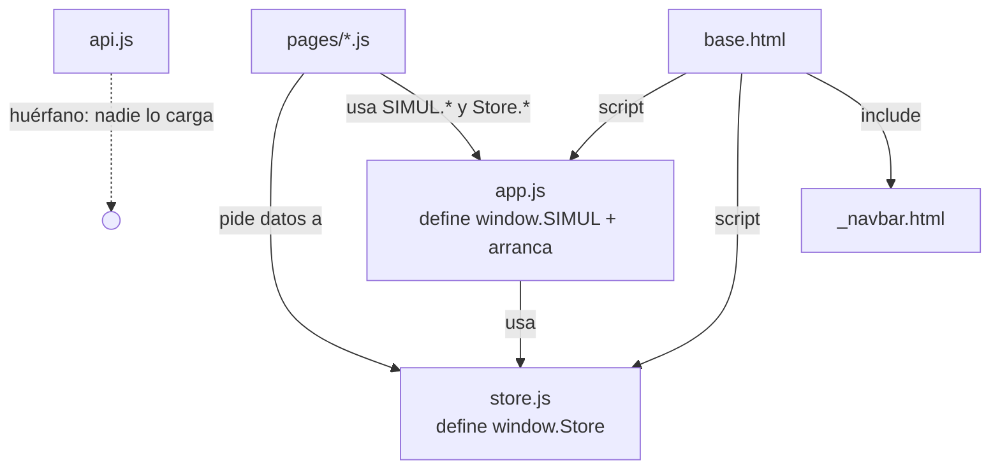

# SIMUL — Documentación Técnica

> **Parte 3: Núcleo del frontend** (`app.js`, `store.js`, `api.js`, `_navbar.html`, `base.html`)
> Continúa a [`ARQUITECTURA.md`](./ARQUITECTURA.md) (Parte 1) y [`DATOS.md`](./DATOS.md) (Parte 2).

---

## Índice

1. [Qué cubre esta parte](#1-qué-cubre-esta-parte)
2. [Orden de carga y arranque](#2-orden-de-carga-y-arranque)
3. [`app.js` línea por línea](#3-appjs-línea-por-línea)
4. [`store.js` línea por línea](#4-storejs-línea-por-línea)
5. [`api.js` — el cliente huérfano](#5-apijs--el-cliente-huérfano)
6. [`_navbar.html` — navegación por rol](#6-_navbarhtml--navegación-por-rol)
7. [El sistema de guardas de extremo a extremo](#7-el-sistema-de-guardas-de-extremo-a-extremo)
8. [Contrato de atributos `data-*`](#8-contrato-de-atributos-data-)
9. [Hallazgos](#9-hallazgos)
10. [Plan de migración Store → API](#10-plan-de-migración-store--api)

---

## 1. Qué cubre esta parte

Cuatro archivos que **no pertenecen a ninguna página en concreto** y que toda la
aplicación comparte. Son el 100% del "framework" casero del proyecto.

| Archivo | Líneas | Rol | Se carga en |
|---|---:|---|---|
| `app/static/js/store.js` | 389 | Estado persistente (localStorage) | `base.html:128` (primero) |
| `app/static/js/app.js` | 471 | Núcleo de UI: guardas, navbar, toasts, modales | `base.html:129` (segundo) |
| `app/static/js/api.js` | 107 | Cliente Axios + JWT | **❌ nunca** |
| `app/templates/partials/_navbar.html` | 278 | Barra superior con bloques por rol | `base.html:107` |
| `app/templates/base.html` | 135 | Plantilla madre (layout) | es la raíz |



---

## 2. Orden de carga y arranque

`base.html` define la estructura y el **orden** de carga. El orden no es arbitrario:

```django
{# base.html:128-129 — el orden importa #}
<script src="{{ url_for('static', filename='js/store.js') }}"></script>  {# 1º: define Store #}
<script src="{{ url_for('static', filename='js/app.js') }}"></script>    {# 2º: usa Store #}

   {# 3º: scripts de la página #}
```

`store.js` **debe** ir primero: `app.js` llama a `Store.*` en su arranque, y los
scripts de página (`pages/*.js`) usan **ambos**. Si se invirtiera, `app.js`
lanzaría `ReferenceError: Store is not defined`.

### Secuencia de arranque

```
Navegador descarga el HTML
   │
   ├── Jinja ya renderizó todo el HTML, incluidos:
   │      <script>window.SIMUL_CONTENT = [...];</script>   ← dentro de page_scripts
   │
   ├── carga store.js → const Store = (() => {...})()
   │
   ├── carga app.js   → IIFE:
   │      ├── define helpers, toast, modal, guardPage…
   │      ├── window.SIMUL = {…}          (API pública)
   │      └── si readyState==='loading' → espera DOMContentLoaded
   │          si no                      → boot() ya
   │
   ├── carga pages/<pagina>.js → su IIFE registra listeners
   │
   └── DOMContentLoaded → boot()
          ├── Store.initContent/Queue/Comments/Reactions/Users(window.SIMUL_*)
          ├── Store.initProposals()
          ├── user = Store.getUser()
          ├── paintAuthBlocks(user)     ← muestra/oculta por sesión y rol
          ├── paintUser(user)           ← rellena nombre, puntos, avatar…
          ├── initNavbar()              ← desplegable + logout
          ├── initFavorites()           ← listeners de ★
          └── dispatch 'simul:ready'    ← las páginas pueden escuchar
```

> ⚠ **Detalle de orden:** `store.js` se ejecuta **antes** de que `boot()` corra,
> pero **después** de que Jinja escribió los `window.SIMUL_*`. Por eso `boot()`
> puede sembrar el `Store` con esos valores globales.

> ⚠ **FOUC (flash de interfaz protegida):** los bloques con `data-requires-auth`
> nacen **visibles** en el HTML y `paintAuthBlocks()` los oculta al ejecutarse.
> Hay un instante en que un visitante ve "Mi Dashboard"/menú de usuario antes de
> que el JS actúe. Ver §9.5.

---

## 3. `app.js` línea por línea

### 3.1 Envoltura y helpers (líneas 1-43)

```javascript
15  (function () {
16    'use strict';
22    const $  = (sel, ctx) => (ctx || document).querySelector(sel);
23    const $$ = (sel, ctx) => Array.from((ctx || document).querySelectorAll(sel));
```

| Línea | Detalle |
|---|---|
| 15 | **IIFE**: todo vive en un ámbito privado; nada se filtra salvo lo que se exponga en `window.SIMUL`. |
| 16 | `'use strict'` → errores silenciosos pasan a ser excepciones (ej. asignar a variable no declarada). |
| 22 | `$` = `querySelector` (primer match). Acepta un contexto opcional para buscar dentro de un nodo. |
| 23 | `$$` = `querySelectorAll` + `Array.from` → devuelve un **array real** (un `NodeList` no tiene `.map`/`.filter`). |

```javascript
26  function escapeHtml(value) {
27    return String(value === null || value === undefined ? '' : value)
28      .replace(/&/g, '&amp;').replace(/</g, '&lt;').replace(/>/g, '&gt;')
31      .replace(/"/g, '&quot;').replace(/'/g, '&#39;');
33  }
```

**`escapeHtml` es la defensa anti-XSS del frontend.** Se aplica a **todo** dato que
se inyecte con `innerHTML`. El orden importa: `&` **primero**, si no se
"re-escaparían" las entidades ya generadas. Es la contramedida correcta en un
proyecto que construye HTML por concatenación de strings (no usa frameworks que
escapen solos).

> ⚠ Es **obligatoria** cada vez que se usa `innerHTML` con datos. Si algún
> `pages/*.js` la omite, hay una vulnerabilidad XSS. (Auditable en la Parte 4.)

```javascript
35  function formatNumber(value) {
36    return Number(value || 0).toLocaleString('es-CO');
37  }
40  function capitalize(text) {
41    const s = String(text || '');
42    return s.charAt(0).toUpperCase() + s.slice(1);
43  }
```

| Función | Uso |
|---|---|
| `formatNumber` | `1240` → `"1.240"` (formato colombiano: punto de miles). `value || 0` evita `NaN`. |
| `capitalize` | `"pendiente"` → `"Pendiente"` para etiquetas de estado. |

### 3.2 Toasts (líneas 45-85) — tabla `NOTIFICACION`

```javascript
49  const TOAST_STYLES = {
50    success: { bg: 'bg-emerald-700', icon: '✓' },
51    error:   { bg: 'bg-red-700',     icon: '✕' },
52    info:    { bg: 'bg-gray-800',    icon: 'ℹ' }
53  };
55  function toast(message, type) {
56    let box = $('#simul-toasts');           // contenedor único, perezoso
58    if (!box) { /* lo crea la 1ª vez */ }
66    const style = TOAST_STYLES[type] || TOAST_STYLES.info;
68    const node = document.createElement('div');
75    node.innerHTML =
76      '<span ...>' + style.icon + '</span>' +
77      '<span>' + escapeHtml(message) + '</span>';
79    box.appendChild(node);
81    setTimeout(function () {
82      node.classList.add('opacity-0', 'translate-y-2');   // fade
83      setTimeout(function () { node.remove(); }, 300);    // y lo quita
84    }, 3000);
85  }
```

| Detalle | Por qué |
|---|---|
| **Contenedor perezoso** (58-64) | Solo se crea el `<div id="simul-toasts">` cuando aparece el primer toast. Si nunca hay toasts, no hay nodo en el DOM. |
| `pointer-events-none` en el contenedor, `pointer-events-auto` en cada toast (70) | Los toasts no bloquean clics en lo que hay debajo, pero sí se pueden cerrar ellos mismos. |
| Doble `setTimeout` (81-84) | 3000 ms visible + 300 ms de animación de salida → el nodo se elimina **después** de desaparecer (evita parpadeo). |
| `escapeHtml(message)` (77) | El mensaje puede venir de datos del usuario → escapado. |

### 3.3 Modal (líneas 87-134)

```javascript
93  function openModal(title, bodyHtml) {
94    closeModal();                        // ← nunca hay 2 modales abiertos
96    const overlay = document.createElement('div');
97    overlay.id = 'simul-modal';
100   overlay.style.background = 'rgba(0,0,0,0.5)';
102   overlay.innerHTML = /* header con título + botón ✕ + bodyHtml */;
122   overlay.addEventListener('click', function (event) {
124     if (event.target === overlay) closeModal();   // clic en el fondo cierra
125   });
127   document.body.appendChild(overlay);
128   return overlay;                      // ← la página puede añadir listeners
129 }
131 function closeModal() { const m = $('#simul-modal'); if (m) m.remove(); }
```

| Detalle | Por qué |
|---|---|
| `closeModal()` al inicio (94) | **Un solo modal** en el DOM. El proyecto reutiliza este contenedor para detalle, rechazo, eliminar, etc. |
| `event.target === overlay` (124) | Solo cierra si el clic fue **en el fondo**, no propagado desde dentro. Patrón estándar. |
| `return overlay` (128) | **Importante:** el llamador recibe el nodo para enganchar listeners a sus botones internos (`[data-modal-close]` ya funciona por delegación global). |
| `escapeHtml(title)` (109) | El título siempre es seguro; `bodyHtml` **no** se escapa (lo construye el llamador, que debe escapar sus datos). |

### 3.4 Navbar (líneas 136-170)

```javascript
142  function initNavbar() {
143    const toggle = $('#simul-user-toggle');
144    const menu   = $('#simul-user-menu');
146    if (toggle && menu) {
147      toggle.addEventListener('click', e => { e.stopPropagation(); menu.classList.toggle('hidden'); });
152      document.addEventListener('click', () => menu.classList.add('hidden'));   // clic fuera cierra
156      menu.addEventListener('click', e => e.stopPropagation());                 // clic dentro no cierra
159    }
163    $$('[data-action="logout"]').forEach(boton => {
164      boton.addEventListener('click', e => {
165        e.preventDefault();
166        Store.logout();
167        window.location.href = '/';
168      });
169    });
170  }
```

| Detalle | Por qué |
|---|---|
| `stopPropagation` (148, 157) | Evita que el clic en el botón/menú "llegue" al `document` y cierre el menú que se acaba de abrir. |
| Delegación con `$$` (163) | Puede haber **varios** botones de logout (navbar **y** perfil) → se enganchan todos. |
| `Store.logout()` + `href='/'` (166-167) | Borra la sesión y vuelve a la portada. **No** recarga la página actual: navega. |

> ⚠ `aria-expanded` está fijado a `"false"` en `_navbar.html:145` y **nunca** se
> actualiza al abrir/cerrar → lector de pantalla no anuncia el estado (§9.9).

### 3.5 `paintUser` — rellenar la sesión (líneas 172-223)

Rellena todos los huecos del HTML marcados con `data-user-*`:

```javascript
173  function paintUser(user) {
174    if (!user) return;
176    $$('[data-user-name]')        .forEach(el => el.textContent = user.name);
180    $$('[data-user-first-name]')  .forEach(el => el.textContent = String(user.name).split(' ')[0]);
184    $$('[data-user-email]')       .forEach(el => el.textContent = user.email);
188    $$('[data-user-avatar]')      .forEach(el => { el.src = user.avatar; el.alt = user.name; });
193    $$('[data-user-points]')      .forEach(el => el.textContent = formatNumber(user.points));
197    $$('[data-user-level]')       .forEach(el => el.textContent = user.level);
201    $$('[data-user-role-label]')  .forEach(el =>
202      el.textContent = (window.SIMUL_ROLE_LABELS || {})[user.role] || user.role);
205    $$('[data-user-description]') .forEach(el =>
206      el.textContent = user.description || 'Agrega una descripcion sobre ti...');
210    $$('[data-nav-dashboard]')    .forEach(el => el.href = Store.dashboardPath(user.role));
215    $$('[data-user-badges]')      .forEach(el => {
216      el.innerHTML = (user.badges || []).map(badge =>
217        '<span ...>' + escapeHtml(badge) + '</span>').join('');
222    });
223  }
```

| Detalle | Por qué |
|---|---|
| `$$` en lugar de `$` (176-215) | Un **mismo dato** puede aparecer en varios sitios (navbar, cabecera de perfil, dashboard). Se rellenan **todos**. |
| `textContent` (no `innerHTML`) | Todo lo que viene del usuario se escribe como **texto** → imposible inyectar HTML. |
| **`innerHTML` solo en badges** (216) | Y ahí **sí** se aplica `escapeHtml`. Es el único punto donde se construye HTML con datos. |
| `data-user-first-name` (180-182) | `split(' ')[0]` → "Valentina" de "Valentina Moreno". Para el saludo compacto del navbar. |
| `data-nav-dashboard` (210-212) | Resuelve el enlace "Mi Dashboard" según el rol → `Store.dashboardPath(role)`. |
| `SIMUL_ROLE_LABELS` (202) | Traduce `student` → `Estudiante` en el cliente (vocabulario definido en `simul_data.py:1037`). |

### 3.6 `guardPage` — la guarda de rutas (líneas 225-246)

La pieza central de seguridad (RNF-SEG-02):

```javascript
231  function guardPage(requiredRole) {
232    const user = Store.getUser();
234    if (!user) {                                    // ① sin sesión
235      window.location.href = '/login';
236      return null;
237    }
239    if (requiredRole && user.role !== requiredRole) { // ② rol equivocado
240      window.location.href = Store.dashboardPath(user.role);
241      return null;
242    }
244    paintUser(user);                                 // ③ sesión válida
245    return user;
246  }
```

| Caso | Resultado |
|---|---|
| Sin sesión | redirige a `/login`, devuelve `null` |
| Rol distinto al exigido | redirige al dashboard **de su** rol |
| Correcto | rellena la UI y devuelve el `user` |

**Uso típico en una página** (patrón de `pages/*.js`):

```javascript
const user = SIMUL.guardPage('admin');   // si no es admin, ya redirigió
if (!user) return;                        // corta la ejecución
```

> ⚠ **Es seguridad de cliente.** El servidor ya envió la página completa con los
> 200 antes de que esto corra. Escribiendo la URL directamente, el HTML llega.
> Ver §9.1.

### 3.7 `paintAuthBlocks` — visibilidad por sesión y rol (líneas 248-271)

El mecanismo declarativo que hace que **una sola navbar** sirva a los 4 estados
(visitante, estudiante, docente, admin):

```javascript
251  $$('[data-requires-auth]').forEach(el => {
252    if (user) el.removeAttribute('data-auth-hidden');
253    else       el.setAttribute('data-auth-hidden', '');
254  });
257  $$('[data-requires-guest]').forEach(el => {
258    if (user) el.setAttribute('data-auth-hidden', '');
259    else       el.removeAttribute('data-auth-hidden');
260  });
263  $$('[data-role]').forEach(el => {
264    const roles = el.getAttribute('data-role').split(/\s+/);   // admite varios roles
265    if (user && roles.indexOf(user.role) !== -1) el.removeAttribute('data-auth-hidden');
267    else                                          el.setAttribute('data-auth-hidden', '');
270  });
```

Y el CSS cierra el círculo (`app.css:227-231`):

```css
[data-requires-auth][data-auth-hidden],
[data-requires-guest][data-auth-hidden],
[data-role][data-auth-hidden] {
    display: none !important;
}
```

| Detalle | Por qué |
|---|---|
| Se pone/quita **un atributo** (`data-auth-hidden`), no una clase | Separa **estado** (atributo) de **presentación** (CSS). HTML semántico. |
| `data-role="student teacher"` (264) | `split(/\s+/)` permite **varios roles** en un mismo bloque (aunque el navbar actual solo usa uno). |
| `display: none !important` | Se salta cualquier `display` de Tailwind sobre el mismo elemento. |

### 3.8 Favoritos (líneas 273-320)

```javascript
281  function paintFavoriteButton(id) {
282    const activo = Store.isFavorite(id);
283    $$('[data-favorite="' + id + '"]').forEach(btn => {
284      btn.textContent = activo ? '★' : '☆';
285      btn.style.color = activo ? '#C9A84C' : '';          // dorado si activo
286      btn.setAttribute('aria-pressed', activo ? 'true' : 'false');
287    });
288  }
290  function initFavorites() {
291    document.addEventListener('click', function (event) {   // delegación global
292      const btn = event.target.closest('[data-favorite]');
293      if (!btn) return;
295      event.preventDefault(); event.stopPropagation();
298      if (!Store.getUser()) { window.location.href = '/login'; return; }  // exige sesión
303      const id = btn.getAttribute('data-favorite');
304      const ahoraEsFavorito = Store.toggleFavorite(id);
306      paintFavoriteButton(id);
307      toast(ahoraEsFavorito ? 'Guardado en favoritos' : 'Eliminado de favoritos',
308            ahoraEsFavorito ? 'success' : 'info');
313      document.dispatchEvent(new CustomEvent('simul:favorites-changed',
314        { detail: { id: id, active: ahoraEsFavorito } }));   // avisa a la página
316    });
319    (Store.getFavorites() || []).forEach(paintFavoriteButton);
320  }
```

| Detalle | Por qué |
|---|---|
| **Delegación en `document`** (291) | Las tarjetas se **repintan dinámicamente** (filtros, favoritos). Enganchar listeners una por una se perdería con cada repintado; delegar en `document` sobrevive a todo. |
| `closest('[data-favorite]')` (292) | Si el clic fue en un hijo del botón (el ★), sube hasta el botón. |
| Guarda de sesión en el **clic** (298) | **Aquí** vive la restricción "solo con sesión", no en el HTML. El botón se pinta siempre (§9.8). |
| `aria-pressed` (286) | ✔ Accesibilidad: anuncia si el botón está activado (toggle). |
| `CustomEvent 'simul:favorites-changed'` (313) | **Desacople**: la página (ej. `/favoritos`) escucha y se repinta, sin que `app.js` sepa de ella. |
| Estado inicial (319) | Al cargar, refleja los ★ ya guardados. |

### 3.9 `boot` — el arranque (líneas 322-345)

```javascript
326  function boot() {
328    if (window.SIMUL_CONTENT)   Store.initContent(window.SIMUL_CONTENT);
329    if (window.SIMUL_QUEUE)     Store.initQueue(window.SIMUL_QUEUE);
330    if (window.SIMUL_COMMENTS)  Store.initComments(window.SIMUL_COMMENTS);
331    if (window.SIMUL_REACTIONS) Store.initReactions(window.SIMUL_REACTIONS);
332    if (window.SIMUL_USERS)     Store.initUsers(window.SIMUL_USERS);
333    Store.initProposals();
335    const user = Store.getUser();
337    paintAuthBlocks(user);
338    if (user) paintUser(user);
339    initNavbar();
340    initFavorites();
342    document.dispatchEvent(new CustomEvent('simul:ready', { detail: { user: user } }));
345  }
```

| Detalle | Por qué |
|---|---|
| `if (window.SIMUL_X)` (328-332) | **Siembra condicional**: cada página solo expone las variables que necesita. En la portada no existe `SIMUL_QUEUE`, y no pasa nada. |
| `initContent` etc. **solo escriben si `null`** | (ver §4) → visitar `/buscar` dos veces **no** resetea los cambios del usuario. La semilla solo entra la primera vez. |
| `dispatch 'simul:ready'` (342) | Punto de enganche para páginas que necesiten esperar a que todo esté listo. |
| **No llama a `Store.initFavorites`** | ⚠ Los favoritos semilla **solo** se siembran en `/favoritos` (§9.4). |

### 3.10 `contentCardHtml` — la tarjeta en JS (líneas 347-414)

Réplica en JavaScript del partial `_content_card.html`. Las páginas que filtran en
el navegador (buscador, favoritos, dashboard) la usan **en vez de** pedir al
servidor una página nueva.

```javascript
356  function contentCardHtml(item) {
357    const tags = (item.tags || []).slice(0, 3).map(tag =>        // máx. 3 tags
358      '<span ...>#' + escapeHtml(tag) + '</span>').join('');
363    const favButton = '<button ... data-favorite="' + escapeHtml(item.id) + '" ...>☆</button>';
370    return '' +
371      '<article class="simul-card ...">' +
372        '<div class="relative h-44 ...">' +
373          '' +
377          '<span class="tag ' + escapeHtml(item.categoryTag || 'tag-blue') + ' ...">' + escapeHtml(item.category) + '</span>' +
379          favButton +
...
407        '<a href="/contenido/' + encodeURIComponent(item.id) + '" ...>Ver detalle</a>' +
413      '</article>';
414  }
```

| Detalle | Por qué |
|---|---|
| **`escapeHtml` en todos los campos** (357-401) | Es una función que construye HTML con datos → cada valor se escapa. Auditoría punto por punto. |
| `slice(0, 3)` (357) | Máximo 3 etiquetas por tarjeta (diseño). |
| `encodeURIComponent(item.id)` (407) | Seguridad en la URL del enlace. |
| `loading="lazy"` (374) | ✔ Rendimiento: las imágenes fuera de pantalla no se cargan hasta hacer scroll. |
| `categoryTag || 'tag-blue'` (377) | Fallback de color si el dato no trae clase. |
| `favButton` **siempre** se incluye (363-368) | ⚠ El comentario dice *"solo se muestra si hay sesión"* pero el código no lo condiciona (§9.8). |

### 3.11 Utilidades de formulario (líneas 416-449)

```javascript
424  function setFieldError(input, message) {
425    const box = input.closest('div').querySelector('.field-error');
426    if (!box) return;
428    box.textContent = message || '';
429    box.classList.toggle('hidden', !message);
431    input.classList.toggle('border-red-400', Boolean(message));
432    input.classList.toggle('focus:ring-red-200', Boolean(message));
433  }
436  function markOption(el, active, activeClass) {     // ← activeClass NUNCA se usa
439    if (active) { el.classList.add('border-[#C8102E]', 'bg-red-50'); ... }
442    else        { el.classList.remove('border-[#C8102E]', 'bg-red-50'); ... }
447    const check = el.querySelector('.role-check');
448    if (check) check.classList.toggle('hidden', !active);
449  }
```

| Función | Para qué |
|---|---|
| `setFieldError` | Todos los formularios comparten un `<div class="field-error hidden">` bajo cada campo. Muestra/borra el mensaje y pinta el borde rojo. |
| `markOption` | Resalta la tarjeta seleccionada en los selectores tipo tarjeta (ej. elección de rol). |
| ⚠ `activeClass` (436) | **Parámetro declarado y jamás usado** — las clases están fijas en el cuerpo (§9.7). |

### 3.12 API pública y disparo (líneas 451-471)

```javascript
456  window.SIMUL = {
457    $: $, $$: $$, escapeHtml: escapeHtml,
458    formatNumber: formatNumber, capitalize: capitalize,
459    toast: toast, openModal: openModal, closeModal: closeModal,
460    guardPage: guardPage, paintUser: paintUser, paintAuthBlocks: paintAuthBlocks,
461    contentCardHtml: contentCardHtml,
462    setFieldError: setFieldError, markOption: markOption
463  };
465  if (document.readyState === 'loading') {
466    document.addEventListener('DOMContentLoaded', boot);
467  } else {
468    boot();
469  }
471  })();
```

Se exponen **14 entradas** en el espacio global `window.SIMUL`: `$`, `$$`,
`escapeHtml`, `formatNumber`, `capitalize`, `toast`, `openModal`, `closeModal`,
`guardPage`, `paintUser`, `paintAuthBlocks`, `contentCardHtml`, `setFieldError` y
`markOption`. Es la superficie que consumen los `pages/*.js`.

> 📌 Lo que **no** se expone y queda privado (solo uso interno de `app.js`): `boot`,
> `initNavbar`, `initFavorites`, `paintFavoriteButton`, `TOAST_STYLES`. Es el patrón
> **módulo revelado** (`Revealing Module Pattern`): el IIFE encapsula todo y devuelve
> únicamente lo que se publica.

---

## 4. `store.js` línea por línea

### 4.1 Envoltura y helpers (líneas 20-45)

```javascript
20  const Store = (() => {           // ← se asigna a global (var implícita de script)
24   function read(key, fallback) {
25     try {
26       const raw = localStorage.getItem(key);
27       return raw === null ? fallback : JSON.parse(raw);
28     } catch (e) { return fallback; }
31   }
33   function write(key, value) {
34     try { localStorage.setItem(key, JSON.stringify(value)); }
36     catch (e) { /* Cuota llena o modo privado: la app sigue en memoria */ }
40     return value;
41   }
43   function remove(key) { localStorage.removeItem(key); }
```

| Detalle | Por qué |
|---|---|
| `read` con `try/catch` (25-30) | Si el JSON está corrupto o no hay, devuelve el `fallback` en vez de crashear toda la app. |
| `raw === null ? fallback` (27) | Distingue "no existe la clave" (→ fallback) de "existe y vale `null`". |
| **`write` con `catch` vacío** (36-39) | Si `localStorage` está lleno o en modo incógnito, **la app no se rompe**: sigue funcionando en memoria, solo no persiste. Decisión defensiva deliberada. |
| `return value` (40) | Los `set*` devuelven lo que guardaron, para encadenar. |

### 4.2 Sesión (líneas 47-121) — tabla `USUARIO`

```javascript
51  function getUser()  { return read('simul.user', null); }
55  function setUser(u) { return write('simul.user', u); }
59  function logout()   { remove('simul.user'); }
64  function roleUsers() { return window.SIMUL_ROLE_USERS || {}; }   // 3 perfiles demo

73  function login(role) {
74    const user = roleUsers()[role];
75    if (!user) return null;
77    return setUser({
78      name: user.name, email: user.email, role: user.role, avatar: user.avatar,
82      points: user.points, level: user.level,
84      badges: user.badges.slice(),        // ← copia, no referencia
85      description: user.description
86    });
87  }
```

| Detalle | Por qué |
|---|---|
| `login(role)` (73) | **No valida contraseña**: recibe el rol y copia el perfil demo. Es el login simulado. La validación real vive en `login.js`. |
| `badges.slice()` (84) | Copia defensiva: evita que mutar la insignia del usuario modifique `roleUsers()` global. |
| ⚠ **`login` no copia el `id`** | El usuario guardado **no tiene `id`** → no se puede asociar a una fila de BD (§9.3). |

```javascript
93  function register(user) {
94    const pendientes = read('simul.pendingUsers', []);
96    pendientes.push(Object.assign(
97      { id: 'u' + Date.now(), points: 0, level: 1, badges: [] }, user));
101   write('simul.pendingUsers', pendientes);
102   return user;
103 }
109 function updateUser(patch) {
110   const current = getUser();
111   if (!current) return null;
112   return setUser(Object.assign({}, current, patch));   // merge superficial
113 }
116 function dashboardPath(role) {                          // RF-USR-02
117   if (role === 'student') return '/dashboard/estudiante';
118   if (role === 'teacher') return '/dashboard/docente';
119   if (role === 'admin')   return '/dashboard/admin';
120   return '/';                                           // ⚠ 'egresado' cae aquí
121 }
```

| Detalle | Por qué |
|---|---|
| `register` (93) | Guarda la cuenta en **`simul.pendingUsers`**, no en `simul.users`. No inicia sesión: debe pasar por login. Añade `id`, `points:0`, `level:1`, `badges:[]` por defecto. |
| `updateUser` (109-113) | Merge superficial (`Object.assign`) → ideal para "guardar perfil". |
| ⚠ `dashboardPath` sin `egresado` (120) | Un egresado va a `/` — coherente con el hallazgo de los dos vocabularios de rol (Parte 2 §9.2). |

### 4.3 Favoritos (líneas 123-162) — tabla `FAVORITO`

```javascript
127  function getFavorites() { return read('simul.favorites', null); }   // ← null por defecto
132  function initFavorites(seed) {
133    if (getFavorites() === null) write('simul.favorites', seed);      // siembra una vez
136    return getFavorites();
137  }
139  function isFavorite(id) { return (getFavorites() || []).indexOf(String(id)) !== -1; }
144  function toggleFavorite(id) {
145    const list = (getFavorites() || []).slice();
146    const key = String(id);
147    const at = list.indexOf(key);
149    if (at === -1) list.push(key); else list.splice(at, 1);
155    write('simul.favorites', list);
156    return at === -1;                      // true = se acaba de añadir
157  }
```

| Detalle | Por qué |
|---|---|
| `null` por defecto (127) | `initFavorites` necesita distinguir "sin lista" (siembra) de "lista vacía" (usuario borró todo). |
| `String(id)` (139,146) | Normaliza: los ids del mock a veces son número, a veces string. |
| `toggleFavorite` **devuelve** el estado (156) | Para que `app.js` sepa si puso o quitó (y muestre el toast correcto). |

### 4.4 Contenido (líneas 164-207) — tabla `CONTENIDO`

```javascript
171  function initContent(seed) { if (read('simul.content',null)===null) write('simul.content',seed); return getContent(); }
178  function getContent()      { return read('simul.content', []); }
182  function findContent(id)   { return getContent().find(c => c.id === String(id)) || null; }
186  function upsertContent(item) {
187    const list = getContent();
188    const at = list.findIndex(c => c.id === String(item.id));
190    if (at === -1) list.unshift(item);                       // nuevo → al principio
193    else           list[at] = Object.assign({}, list[at], item);   // merge
196    write('simul.content', list); return item;
198  }
200  function setContentStatus(id, status) { return upsertContent({ id: String(id), status: status }); }
204  function deleteContent(id) { write('simul.content', getContent().filter(c => c.id !== String(id))); }
```

| Detalle | Por qué |
|---|---|
| **`upsert`** (186-198) | Una sola función para crear y editar (según exista el id). `unshift` pone el nuevo al principio (los más recientes primero, como espera el dashboard). |
| **merge en `Object.assign`** (193) | `setContentStatus` solo pasa `{id,status}` → **conserva el resto** de campos. Es la clave de que cambiar estado no borre el contenido. |
| **Copia editable** (docstring 166-168) | Esto convierte el catálogo del servidor en una lista **modificable** que sobrevive recargas. Es el corazón del "mock editable". |

### 4.5 Bandeja de validación (líneas 209-226) — `CONTENIDO.estado`

```javascript
213  function initQueue(seed) { if (read('simul.queue',null)===null) write('simul.queue',seed); return getQueue(); }
220  function getQueue()      { return read('simul.queue', []); }
224  function dropFromQueue(id) { write('simul.queue', getQueue().filter(i => i.id !== String(id))); }
```

⚠ Aquí está el **bug de los tres IDs** (Parte 2 §9.1): `dropFromQueue("p1")` **no**
toca `simul.content["7"]`. Son listas **independientes**.

### 4.6 Comentarios (líneas 228-258) — tabla `COMENTARIO`

```javascript
233  function initComments(seed) { ... }
240  function getComments(contentId) {
241    const all = read('simul.comments', []);
242    return all.filter(c => c.contentId === String(contentId));   // filtra por contenido
243  }
245  function addComment(contentId, author, text, parentId) {
247    const comment = {
248      id: 'c' + Date.now(), contentId: String(contentId), author: author,
251      text: text, time: 'Ahora', parentId: parentId || null
254    };
255    all.unshift(comment); write('simul.comments', all); return comment;
258  }
```

| Detalle | Por qué |
|---|---|
| `getComments` **filtra** (242) | Guarda **todos** los comentarios en una lista y filtra por contenido al leer. Es el patrón de una futura tabla con FK. |
| `parentId` (253) | FK autoreferenciada para hilos (§Parte 2). Por defecto `null` (comentario raíz). |
| `time: 'Ahora'` (252) | Texto fijo "Ahora" (no calcula tiempo real). Simplificación de demo. |

### 4.7 Reacciones (líneas 260-292) — tabla `REACCION`

```javascript
264  function initReactions(seed) { ... }
271  function getReactions(contentId) {
272    return read('simul.reactions', {})[String(contentId)] ||
273           { emoji: '👏', count: 0, reacted: false };      // valor por defecto
274  }
276  function toggleReaction(contentId) {
277    const all = read('simul.reactions', {});
278    const key = String(contentId);
279    const current = all[key] || { emoji:'👏', count:0, reacted:false };
281    const next = {
282      emoji: current.emoji,
283      count: current.reacted ? Math.max(current.count - 1, 0) : current.count + 1,
286      reacted: !current.reacted
287    };
289    all[key] = next; write('simul.reactions', all); return next;
292  }
```

| Detalle | Por qué |
|---|---|
| Estructura **dict** (no lista) (272) | Se accede por `contentId` en O(1). Más eficiente que filtrar. |
| `Math.max(count-1, 0)` (284) | Nunca baja de 0 (defensa contra contador negativo). |
| `reacted` (286) | Recuerda si **este** usuario reaccionó → el emoji se pinta activo y el conteo se puede revertir. |

### 4.8 Propuestas (líneas 294-331)

```javascript
298  function initProposals() { if (read('simul.proposals',null)===null) write('simul.proposals',[]); return getProposals(); }
305  function getProposals()  { return read('simul.proposals', []); }
309  function getProposalsByTeacher(teacherId) { return getProposals().filter(p => p.teacherId === teacherId); }
313  function addProposal(data) {
315    const proposal = Object.assign({
316      id: 'prop-' + Date.now(), status: 'pendiente',
318      createdAt: new Date().toISOString()
319    }, data);
321    list.unshift(proposal); write('simul.proposals', list); return proposal;
324  }
326  function updateProposalStatus(id, status) { /* map + merge */ }
```

| Detalle | Por qué |
|---|---|
| `getProposalsByTeacher` (309) | Alimenta el panel del docente (RF-PRY-02): "proyectos que asesoro". |
| `Object.assign(defaults, data)` (315) | **El `data` gana**: si trae `id`, se respeta; si no, usa el timestamp. |
| `createdAt` ISO (318) | Fecha real (`new Date().toISOString()`), a diferencia del `time: 'Ahora'` de comentarios. |

### 4.9 Usuarios del sistema (líneas 333-360) — tabla `USUARIO`

```javascript
337  function initUsers(seed) { ... }
344  function getUsers()      { return read('simul.users', []); }
348  function setUserRole(id, role)  { write('simul.users', getUsers().map(u =>
349      u.id === String(id) ? Object.assign({}, u, { role: role }) : u)); }
354  function toggleUserActive(id)   { write('simul.users', getUsers().map(u =>
356      u.id === String(id) ? Object.assign({}, u, { active: !u.active }) : u)); }
```

Corresponden a las acciones de `/admin/usuarios` (RF-USR-05).

### 4.10 `reset` y API pública (líneas 362-389)

```javascript
367  function reset() {
368    ['simul.user','simul.favorites','simul.content','simul.queue',
369     'simul.comments','simul.reactions','simul.proposals','simul.users',
370     'simul.pendingUsers'].forEach(remove);
373  }
375  return { read, write, remove, reset, getUser, setUser, logout, updateUser,
378    dashboardPath, login, register, getPendingUsers, roleUsers,
379    getFavorites, initFavorites, isFavorite, toggleFavorite, removeFavorite,
380    initContent, getContent, findContent, upsertContent, setContentStatus, deleteContent,
382    initQueue, getQueue, dropFromQueue, initComments, getComments, addComment,
384    initReactions, getReactions, toggleReaction,
385    initProposals, getProposals, getProposalsByTeacher, addProposal, updateProposalStatus,
387    initUsers, getUsers, setUserRole, toggleUserActive };
388 })();
```

`reset()` borra las **9 claves** — el "botón de demo" que devuelve todo al estado
inicial. Expone **42 funciones** (`window.Store`).

> 📌 El docstring de cabecera (líneas 9-17) documenta **8** claves pero el código usa
> **9**: falta `simul.pendingUsers` (§9.6).

---

## 5. `api.js` — el cliente huérfano

**Nadie lo carga.** No está en `base.html` ni en ningún `page_scripts`, y **tampoco
se carga `axios`** desde ningún CDN. Es código **preparado pero muerto**, listo para
cuando se cablee el museo a la API del profesor.

```javascript
 1  const api = axios.create({
 8    baseURL: "/api",
10    headers: { "Content-Type": "application/json" }
15  });
34  api.interceptors.request.use(function (config) {
38    const token = localStorage.getItem("access_token");     // ← clave del token
44    if (token) config.headers.Authorization = `Bearer ${token}`;
51    return config;
52  });
75  api.interceptors.response.use(function (response) { return response; },
83    function (error) {
85      if (error.response && error.response.status === 401) {
90        localStorage.removeItem("access_token");
94        localStorage.removeItem("user");                     // ← clave de sesión
99        window.location.reload();
100     }
103     return Promise.reject(error);
106   });
```

| Detalle | Por qué |
|---|---|
| `baseURL: "/api"` (8) | Todas las llamadas van al prefijo de la API (`/api/auth`, `/api/products`). |
| Request interceptor (34-61) | Añade `Authorization: Bearer <token>` automáticamente a **todas** las peticiones. |
| Response interceptor (75-106) | Si el backend responde **401** (token vencido), limpia y recarga. |
| ⚠ **Claves incompatibles** | `api.js` usa `access_token` y `user`; el `Store` usa `simul.user`. Si se cableara tal cual, **el interceptor no cerraría la sesión** (§9.2). |
| ⚠ `const api` global (1) | Fuera de IIFE → contamina el espacio global. |

---

## 6. `_navbar.html` — navegación por rol

El HTML se entrega **completo para todos**; `app.js` decide qué mostrar. El
docstring (líneas 1-13) lo explica: *"el servidor no necesita conocer el estado de
sesión: la barra se renderiza una vez y el navegador la adapta"*.

### Estructura

| Zona | Elemento | Guarda |
|---|---|---|
| Logo (27-48) | `url_for('web.index')` | siempre |
| Enlaces (54-92) | Explorar · Eventos · Hall de la Fama · Ranking | siempre |
| Mi Dashboard (104-118) | `data-requires-auth` + `data-nav-dashboard` | solo sesión (href por rol) |
| Buscador (122-132) | `url_for('web.buscar')` | siempre |
| Menú usuario (138-260) | `data-requires-auth` | solo sesión |
| Botón sesión (266-272) | `data-requires-guest` | solo visitante |

### Menú de usuario — atajos por rol (RNF-SEG-02)

| Enlace | `data-role` | Línea |
|---|---|---|
| Mis Aportes | `student` | 211 |
| Favoritos | `student` | 217 |
| Ranking | `student` | 223 |
| Registrar Contenido | `teacher` | 229 |
| Bandeja Validación | `admin` | 235 |
| Gestionar Usuarios | `admin` | 241 |
| Cerrar sesión (`data-action="logout"`) | — (todos) | 248 |

**Cabecera del menú** (173-186) con `data-user-name`, `data-user-email`,
`data-user-points`, `data-user-level` → rellenados por `paintUser`.

> ⚠ Los enlaces "Eventos" y "Hall" (66, 75) usan `url_for('web.buscar', cat='eventos')`
> y `cat='hall'`. **Ninguno** apunta a `galeria` (coherente con el hueco de la
> categoría, Parte 2 §9.3).

---

## 7. El sistema de guardas de extremo a extremo

Cómo se restringe el acceso a una página privada (ej. `/dashboard/admin`):

```
① Usuario escribe la URL /dashboard/admin
       │
② web_routes.dashboard_admin()  → render_template(...)   ⚠ SIN comprobar sesión
       │  (el servidor responde 200 con TODO el HTML)
       ▼
③ base.html incluye _navbar.html completo (todos los bloques)
       │
④ carga store.js, app.js
       │
⑤ dashboard_admin.js llama a:  SIMUL.guardPage('admin')
       │
       ├─ Store.getUser() === null         → window.location='/login'
       ├─ user.role !== 'admin'            → window.location = dashboardPath(user.role)
       └─ ok                               → paintUser(user); continúa
```

**Conclusión:** la protección es **cosmética/UX**, no de seguridad. El HTML de un
dashboard admin llega a cualquier navegador que pida la URL. La seguridad real solo
existe en `/api/*` (JWT), que el museo no usa.

### Doble mecanismo de visibilidad

Hay **dos** sistemas que ocultan cosas por rol, y conviene no confundirlos:

| Mecanismo | Dónde | Qué hace |
|---|---|---|
| `guardPage(role)` | `pages/*.js` | **Redirige** si el rol no coincide (bloquea la vista) |
| `data-role` + `paintAuthBlocks` | `app.js` / `_navbar.html` | **Oculta elementos** (enlaces del menú) |

---

## 8. Contrato de atributos `data-*`

El protocolo entre HTML (Jinja) y JavaScript. Es el "contrato declarativo" del proyecto:

| Atributo | Quién lo lee | Efecto |
|---|---|---|
| `data-requires-auth` | `paintAuthBlocks` | visible **solo** con sesión |
| `data-requires-guest` | `paintAuthBlocks` | visible **solo** sin sesión |
| `data-role="student teacher"` | `paintAuthBlocks` | visible **solo** si el rol coincide |
| `data-auth-hidden` | JS lo pone/quita, CSS lo usa | `display:none !important` |
| `data-nav-dashboard` | `paintUser` | fija `href` según el rol |
| `data-user-name` | `paintUser` | `textContent = user.name` |
| `data-user-first-name` | `paintUser` | primera palabra del nombre |
| `data-user-email` | `paintUser` | correo |
| `data-user-avatar` | `paintUser` | `src` y `alt` |
| `data-user-points` | `paintUser` | puntos formateados |
| `data-user-level` | `paintUser` | número de nivel |
| `data-user-role-label` | `paintUser` | etiqueta traducida (`SIMUL_ROLE_LABELS`) |
| `data-user-description` | `paintUser` | descripción (o placeholder) |
| `data-user-badges` | `paintUser` | lista de insignias (HTML) |
| `data-favorite="<id>"` | `initFavorites` | botón de favorito (toggle) |
| `data-action="logout"` | `initNavbar` | cierra sesión |
| `data-modal-close` | (delegación) | cierra el modal |
| `data-nav="<nombre>"` | (reservado) | sin uso actual |

> Los `data-user-*` son el "binding" del proyecto: cambiar la sesión = volver a
> llamar `paintUser()`.

---

## 9. Hallazgos

### 🔴 9.1 Seguridad de cliente (recordatorio de Parte 1 §11.2)

Todo el control de acceso del museo (`guardPage`, `data-role`) es **burlable**.
El servidor nunca comprueba la sesión del museo.

### 🔴 9.2 `api.js` incompatible con `Store`

| `api.js` usa | `Store` usa |
|---|---|
| `access_token` | (no existe; el token nunca se guarda) |
| `user` | `simul.user` |

Si se cableara `api.js` sin cambios, **nunca** encontraría el token (porque el login
simulado no lo guarda) y **nunca** limpiaría la sesión al recibir un 401.

### 🟠 9.3 El usuario guardado no tiene `id`

`Store.login()` copia nombre, email, rol, puntos… **pero no el `id`**. Sin `id`,
ninguna llamada futura a la API puede saber *qué* usuario es. `register()` sí lo
genera (`'u'+Date.now()`), pero se queda en `pendingUsers`.

### 🟠 9.4 Los favoritos semilla solo existen si visitaste `/favoritos`

`boot()` **no** llama a `Store.initFavorites(seed)`. Solo lo hace
`pages/favoritos.js:25`. Consecuencia: un usuario que navegue directamente a
`/buscar` y pulse ★ empieza con lista vacía, mientras que el que pasó antes por
`/favoritos` tendrá 4. **Comportamiento no determinista según el recorrido.**

### 🟠 9.5 FOUC de interfaz protegida

Los bloques `data-requires-auth` **nacen visibles**. Un visitante ve
momentáneamente "Mi Dashboard", el menú de usuario y el avatar antes de que
`paintAuthBlocks()` los oculte. Se soluciona añadiendo `data-auth-hidden` en el
HTML del servidor para el caso por defecto.

### 🟡 9.6 `simul.pendingUsers` no está en el docstring

Las líneas 9-17 listan 8 claves; el código usa 9: falta `simul.pendingUsers` en el
docstring de cabecera. (`reset()` sí lo incluye correctamente, línea 371.)

### 🟡 9.7 Colisión de nombre `initFavorites`

* `app.js:290` → `initFavorites()`: engancha los listeners de los botones ★.
* `store.js:132` → `Store.initFavorites(seed)`: siembra la lista.

Dos funciones **distintas** con el **mismo nombre** en ámbitos distintos. Es
correcto por el ámbito (una es privada de `app.js`, la otra es `Store.*`), pero
confunde al leer.

### 🟡 9.8 Comentario falso en `contentCardHtml`

Línea 362: *"El botón de favorito solo se muestra si hay sesión"*.
**El código no lo condiciona** (líneas 363-368): el botón se pinta siempre. La
restricción real está en el clic (`initFavorites`, línea 298).

### 🟡 9.9 `aria-expanded` nunca se actualiza

`_navbar.html:145` fija `aria-expanded="false"`; `initNavbar` cambia `classList`
pero **no** este atributo. Un lector de pantalla no anuncia si el menú está abierto.

### 🟡 9.10 Parámetro `activeClass` sin usar

`app.js:436` declara `markOption(el, active, activeClass)` y **nunca** usa el
tercer parámetro: las clases `border-[#C8102E]`/`bg-red-50` están fijas en el cuerpo.

### 🟡 9.11 Numeración de secciones duplicada en `app.js`

Hay **dos** secciones "5." (GUARDA DE RUTAS y BOTONES DE FAVORITO) y **dos** "6."
(ARRANQUE y TARJETA DE CONTENIDO). Los comentarios internos no coinciden con el
índice de responsabilidades de la cabecera (líneas 5-10, que lista solo 4).

### 🟡 9.12 `login()` no valida nada

`Store.login(role)` confía en `window.SIMUL_ROLE_USERS`. La validación de correo y
contraseña ocurre en `login.js` (capa de página). Si otro código llamara a
`Store.login('admin')` directamente, **entraría como admin sin contraseña**.

---

## 10. Plan de migración Store → API

`store.js` está diseñado para ser **el único archivo que cambie** al conectar la
API (lo dice su docstring, líneas 5-7). Tabla de equivalencias:

| Función de `Store` | Endpoint equivalente | Método |
|---|---|---|
| `login(role)` | `/api/auth/login` | POST |
| `register(user)` | `/api/auth/register` | POST |
| `getUser()` | `/api/auth/me` (a crear) | GET |
| `updateUser(patch)` | `/api/users/me` (a crear) | PUT |
| `getContent()` / `findContent(id)` | `/api/contenido/` | GET |
| `upsertContent(item)` | `/api/contenido/` · `/<id>` | POST · PUT |
| `setContentStatus(id,status)` | `/api/contenido/<id>/estado` | PATCH |
| `deleteContent(id)` | `/api/contenido/<id>` | DELETE |
| `getFavorites()` / `toggleFavorite(id)` | `/api/favoritos/` | GET · POST/DELETE |
| `getComments(id)` / `addComment(...)` | `/api/contenido/<id>/comentarios` | GET · POST |
| `toggleReaction(id)` | `/api/contenido/<id>/reacciones` | POST |
| `getProposals()` / `addProposal(...)` | `/api/propuestas/` | GET · POST |
| `getQueue()` / `dropFromQueue(id)` | `/api/admin/bandeja` | GET · PATCH |
| `getUsers()` / `setUserRole(...)` | `/api/admin/usuarios` | GET · PATCH |
| `roleUsers()` | — (desaparece: ya no hay perfiles demo) | — |
| `reset()` | — (desaparece: botón solo de demo) | — |

### Pasos concretos

1. **Guardar el token** en `login` (hoy no se guarda) → `localStorage.access_token`.
2. **Unificar la clave de sesión** (`api.js` usa `user`; `Store` usa `simul.user`).
3. **Cargar `axios` y `api.js`** en `base.html` (hoy huérfanos).
4. **Convertir cada método `Store` a `async`** y sustituir el cuerpo por una
   llamada a `api.*`. **Las páginas no cambian** si se mantiene la misma firma.
5. **Guardar el `id`** del usuario en `login()` (§9.3).
6. **Migrar `guardPage` a un decorador de servidor** (§9.1).

---

*Documento generado a partir del análisis de `app.js` (471), `store.js` (389),
`api.js` (107), `_navbar.html` (278) y `base.html` (135).*
*Parte 3 de 5. Sigue: Parte 4 — Páginas (21 HTML + 15 JS) y Parte 5 — Estilos (`app.css`).*
